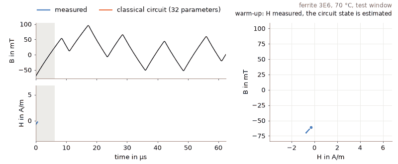
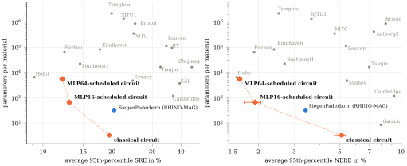
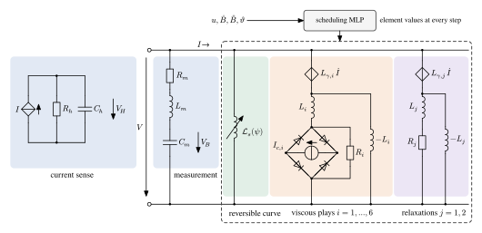

# A Data-Driven, Gain-Scheduled Equivalent Circuit for the B–H Behavior of Power Ferrites



Code, trained models and results of the paper (Wilhelm Kirchgässner, 2026; [arXiv paper](https://arxiv.org/abs/2611.02222)).

An equivalent circuit of the $BH$ behavior of power ferrites is designed from classical elements of hysteresis modeling, discretized, and fitted to the measured transients of the [MagNet Challenge 2](https://github.com/minjiechen/magnetchallenge-2) (MC2) data set by gradient descent through the recurrence, with a fused GPU kernel in [Triton](https://github.com/triton-lang/triton) for the time loop.
The classical circuit has 32 parameters per material.
Its element values can be gain-scheduled with a small MLP per material, which sets them at every step from the excitation, while the hysteresis memory stays in the states of the circuit.



SRE is the sequence relative error, the RMS error of the predicted $H$ relative to the RMS of the measured $H$ over the predicted part of a window.
NERE is the normalized energy relative error, the error of the energy $\int H\,\mathrm{d}B$ over the predicted part; the challenge normalizes it by the core loss of the recording (the energy error in the figure and the table).
The challenge ranked the entries by the 95th percentile (p95) of both, averaged over the three warm-up lengths and the five final-evaluation materials.

On the 15 materials of MC2:

| | parameters per material | mean test SRE (%) | official p95 SRE / energy error (%) |
|---|---:|---:|---:|
| RHINO-MAG GRU8 (challenge winner) | 336 | 7.77 | 20.4 / 3.4 |
| classical circuit (10 training seeds) | 32 | 7.33 ± 0.03 | 19.4 / 5.1 |
| MLP16-scheduled circuit (10 seeds) | 656 | 5.27 ± 0.04 | 13.0 / 1.9 |
| MLP64-scheduled circuit (10 seeds) | 5552 | 4.81 ± 0.02 | 12.1 / 1.6 |

The MLP64-scheduled circuit would rank second of 33 in the challenge by both metrics.
All circuits additionally use the 33 parameters per material of the warm-up state estimator.

## Model

The classical circuit, a 32-parameter model built only from classical elements of hysteresis modeling, predicts the field strength $H$ from the flux density $B$ of power ferrites under arbitrary excitation:

- a second-order correction of the measured flux density and a first-order lag of the measured field strength (the acquisition chain),
- a reversible saturation curve,
- six rate-dependent (viscous) play operators forming a Prandtl–Ishlinskii model with a weight density linear in the logarithm of the play width,
- two linear relaxation states (magnetic after-effect),
- a mean-field feedback of $H$ into every operator, as in the moving Preisach and Jiles–Atherton models.

All coefficients are at most linear in temperature.
The scheduled circuits keep this structure: per material, an MLP with 16 or 64 hidden units maps the excitation at each step to the reversible curve, the hysteresis gain and the operator dynamics (play widths and feedback gains), and it is trained jointly with the 32 circuit parameters.

The classical circuit can be read: measurement and material parameters separate, the material part is a discretized ODE that can be evaluated at any time step, and it has an exact equivalent circuit of positive inductors, resistors and diode-bridge sliders plus controlled sources, which reproduces it in SPICE:



## Repository

```
ferrite_bh/   NumPy implementation, fitted parameters (JSON) and SPICE subcircuits of the classical circuit,
              and the PyTorch API of all trained circuits (ferrite_bh.Circuit)
src/          model, training, evaluation, checks, tables and figures (one script each, docstring = usage)
configs/      run configurations (model variants trained together in one run)
models/       trained checkpoints of every run in the paper (all variants of a run per file)
results/      evaluation results that the tables and figures are built from
data/         not included: raw data (data/raw/), cached windows and the RHINO-MAG GRU8 results (see Data)
paper/        Typst source of the paper and its supplement, generated tables (paper/tables/) and figures (paper/fig/)
scripts/      reproduce.sh: every experiment, table and figure
tests/        pytest suite (no measurement data needed)
```

Main files:

| file | content |
|---|---|
| `src/compact_m.py` | the model (`CompactM`, all variants as options) and its training |
| `src/scan.py` | fused Triton kernel of the recurrence with hand-derived adjoint; `scan_ref` is the plain PyTorch reference |
| `src/mc2lib.py` | data loading, window sampling, metrics (SRE, NERE) |
| `src/eval_m.py`, `src/official_eval.py`, `src/main_stats.py` | test evaluation, official MC2 metric (95th percentiles), statistics |
| `src/finetune_m.py` | refitting parameter groups on another specimen (MC2 → MC1 transfer) |
| `src/spice_check.py`, `src/ode_check.py`, `src/upsample_check.py`, `src/ekf_eval.py` | equivalent circuit in ngspice, step-size consistency, measurement correction at other steps, Kalman-filter estimator |
| `src/hyper_m.py`, `src/scan_tv.py` | the gain-scheduled circuit (per-material MLP on the element values) and its kernel with per-step coefficients |
| `src/hyper_analysis.py` | energy balance of the scheduled circuit (parametric pumping of the time-varying inductors) |

## Setup

[uv](https://docs.astral.sh/uv/) installs the environment from `pyproject.toml` / `uv.lock`, with this repository as an editable package (`import ferrite_bh` and the modules in `src/` work from any directory):

```
uv sync
```

The lock file pins PyTorch for NVIDIA GPUs (CUDA 12.8, with Triton).
The results of the paper were computed on an AMD GPU with ROCm 6.4; for that, follow the comment in `pyproject.toml` before `uv sync`.
Without a GPU the model runs on the plain PyTorch reference of the kernel: evaluation and all tables and figures work, training is impractically slow.

## Data

The measurement data are not redistributed here.
Download them into `data/raw/` and convert them:

| source | place as |
|---|---|
| MC2 training data, 10 materials ([MagNet Challenge 2](https://github.com/minjiechen/magnetchallenge-2)) | `data/raw/mc2/Training Data/<material>.zip` |
| MC2 training data of the 5 final-evaluation materials | `data/raw/mc2/evaltrain/Material <A-E>/` |
| MC2 labeled test set of these 5 materials | `data/raw/mc2/test-set-5-eval-materials.zip` |
| MagNet raw data, for the transfer study ([MagNet Challenge 1](https://github.com/minjiechen/magnetchallenge)) | `data/raw/mc1/Raw Data.zip` |

```
cd src && uv run python prepare_data.py
```

The test and validation windows are drawn reproducibly from the data on first use and cached in `data/`.

The comparison with the GRU8 baseline needs its predictions on the same windows, `data/<material>_rhino_res.npy`.
They are not included; `src/eval_rhino.py` computes them from the published RHINO-MAG models, run in the [RHINO-MAG](https://github.com/upb-lea/RHINO-MAG) environment.

## Reproducing the paper

```
scripts/reproduce.sh                 # everything, about 40 GPU hours on one AMD RX 9070 XT
scripts/reproduce.sh tables figures  # only the tables and figures, from the included results and checkpoints
```

Steps: `final` (classical circuit and energy-error weights, 10 seeds), `path` (smaller models, 10 seeds of the 31- and 27-parameter variants), `ablation`, `ood` (extrapolation and data efficiency, with a GRU8 replica and the MLP64-scheduled circuit), `transfer` (MC2 → MC1 specimens), `checks` (SPICE, step size, Kalman filter), `schedule` (gain-scheduled circuits, 16 and 64 hidden units, 10 seeds each, and the energy check), `export` (JSON, SPICE subcircuits and their checks), `tables`, `figures`, `paper` (compiles `paper/main.pdf` and `paper/supplement.pdf` with Typst).
The GRU8 baseline results must be computed first (see Data).

## Using the model

### NumPy

The classical circuit with NumPy only (see `AGENTS.md` for conventions and pitfalls):

```python
import ferrite_bh as fb

fb.materials()                                # the 15 materials
H = fb.simulate("N87", B, T=25)               # open loop from the demagnetized state, B in T at 16 MHz starting at 0
H = fb.predict("N87", B, H_warmup, T=25)      # MC2 setting: measured H over the first k samples sets the state
fb.coefficients("N87", T=25)                  # a1, Bs, play widths and weights, relaxations, feedback gains, ...
```

Both `simulate` and `predict` take one window, `B` of shape `(W,)`, or a batch of windows, `B` of shape `(N, W)` with `H_warmup` of shape `(N, k)` and the temperature as a scalar or one per window, `T` of shape `(N,)`; `H` has the shape of `B`.
For example, the MC2 test windows of a material at once:

```python
H = fb.predict("N87", B, H_warmup, T=T)       # B (N, 1000), H_warmup (N, 500), T (N,) -> H (N, 1000)
```

Or use the command line (B and H as one column each, in T and A/m at 16 MHz):

```
python -m ferrite_bh list                                            # materials with their test errors
python -m ferrite_bh simulate N87 --T 25 --B b.csv --out h.csv       # open loop from the demagnetized state
python -m ferrite_bh predict N87 --T 25 --B b.csv --H h_warmup.csv   # MC2 setting
```

The fitted parameters are also available as plain JSON, `ferrite_bh/params/<material>.json`: the 32 parameters by name, with units and descriptions, plus the warm-up estimator, validity range and test errors.
The NumPy implementation reproduces the PyTorch model to 1e-4 % (`results/check_numpy.txt`).

### SPICE

`ferrite_bh/spice/<material>.lib` holds the equivalent circuit of each material as a SPICE subcircuit with two terminals, the winding of a core: the voltage across them is $N A_e \, \mathrm{d}B/\mathrm{d}t$, the current into the first terminal is $H l_e / N$.
Temperature `Tc` in °C, the number of turns `N`, the effective cross-section `Ae` in m² and the effective path length `le` in m are parameters of the subcircuit.
It models the material only, without the measurement correction and lag of the MC2 test bench, as `fb.simulate(..., material_only=True)`.
For example, with ngspice, the MC2 specimen of N87 driven by a sinusoidal winding voltage (0.1 T peak at 100 kHz):

```
* N87, R34.0x20.5x12.5 core with 5 turns
.include ferrite_bh/spice/N87.lib
V1 p 0 SIN(0 25 100k 0 0 90)
X1 p 0 N87_core params: Tc=25 N=5 Ae=82.6e-6 le=0.08206
.options method=gear
.tran 15.625n 50u 0 15.625n uic
.end
```

`uic` starts the simulation from the demagnetized state (all inductor currents zero) instead of a DC operating point.
Time steps of at most 62.5 ns / 4 and `method=gear` are recommended.
The subcircuits match the NumPy circuit to a median of 0.1 % (`results/check_spice_lib.txt`); `python -m ferrite_bh spice` regenerates them from the JSON parameters.

### PyTorch

All three circuits through the same call as `fb.predict` (GPU if available; NumPy arrays or tensors, one window or a batch as above):

```python
import ferrite_bh as fb

c = fb.Circuit("mlp64")                       # "classical", "mlp16" or "mlp64" (MLP-scheduled), seed=0 by default
c.materials                                   # the 15 materials
H = c.predict("N87", B, H_warmup, T=T)        # MC2 setting, as fb.predict
```

`fb.Circuit(..., seed=s)` selects another training seed (`fb.seeds("mlp64")` lists the included ones); the checkpoints behind it are in `models/` (see `ferrite_bh/circuit.py`).
`fb.Circuit` needs PyTorch; the NumPy functions above do not.

## Tests

```
uv run --group dev pytest
```

The tests need no measurement data; they run on synthetic excitation within about a minute:

| file | checks |
|---|---|
| `tests/test_kernels.py` | the fused Triton kernels (constant and per-step coefficients) equal their PyTorch references, forward and backward (GPU only) |
| `tests/test_numpy_vs_torch.py` | the NumPy package reproduces the trained PyTorch classical circuit for all 15 materials; the PyTorch API handles single windows, batches, arrays and tensors |
| `tests/test_numpy_api.py` | passivity constraints of the fitted coefficients, positive loop energy in periodic steady state, odd symmetry, batching |
| `tests/test_scheduled.py` | with the scheduling MLP switched off, the scheduled circuit is exactly the classical one; parameter counts 656 and 5552 |
| `tests/test_spice.py` | the SPICE subcircuits match the NumPy circuit (skipped without ngspice; set `NGSPICE` to its path) |
| `tests/test_metrics.py` | the challenge metrics SRE and NERE |

The code passes `uv run --group dev ruff check` (configuration in `pyproject.toml`) and `uv run --group dev ty check`.

## License

MIT (see `LICENSE`).
The measurement data are subject to the terms of the MagNet Challenge.

## Citation

```bibtex
@misc{kirchgässner2026datadrivengainscheduledequivalentcircuit,
      title={A Data-Driven, Gain-Scheduled Equivalent Circuit for the B-H Behavior of Power Ferrites}, 
      author={Wilhelm Kirchgässner},
      year={2026},
      eprint={2611.02222},
      archivePrefix={arXiv},
      primaryClass={eess.SY},
      url={https://arxiv.org/abs/2611.02222}, 
}
```
